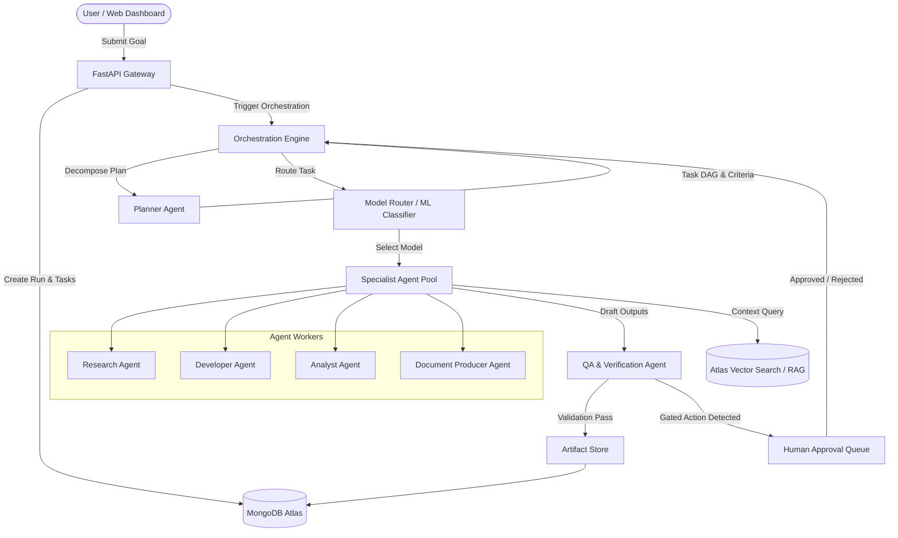

# Autonomous AI Multi-Agent Orchestration Platform

An enterprise-grade, stateful multi-agent orchestration architecture designed for complex goal decomposition, parallel execution, machine-learning-based model routing, and human-in-the-loop safety verification.

## System Overview

## Architectural Layers

1. **Frontend Dashboard (React + TypeScript + Vite)**:
   - Interactive Task DAG visualizer showing dependencies, node statuses, and retries.
   - Real-time run monitoring and execution logs.
   - Human-in-the-loop approval center for gated or destructive actions.
   - Artifact preview and download center (markdown, code, JSON, logs).

2. **API & Gateway Layer (FastAPI + Pydantic)**:
   - High-throughput asynchronous endpoints for Projects, Runs, Tasks, Approvals, and Artifacts.
   - Strict schema validation and status transition enforcement.
   - Health probes and metrics reporting.

3. **Orchestration Layer**:
   - Directed Acyclic Graph (DAG) task scheduler supporting parallel branch execution.
   - Persistent task states: `pending`, `ready`, `running`, `completed`, `failed`, `needs_review`.
   - Checkpoint recovery ensuring long workflows resume seamlessly from failure points.

4. **Model Router (Hybrid Inference + ML Router)**:
   - Rule-based capability and complexity baseline router.
   - Trained scikit-learn classifier routing tasks based on category, prompt length, required tools, and latency/cost targets.
   - Model adapter supporting local Ollama (`qwen2.5`, `llama3.2`, `deepseek-coder`) with resilient Cloud API fallbacks (Gemini 2.5, OpenAI).

5. **Storage & Memory Layer**:
   - MongoDB Atlas collections: `projects`, `runs`, `tasks`, `agents`, `model_registry`, `task_attempts`, `approvals`, `artifacts`, `evaluations`.
   - Vector Search for semantic project retrieval and source citation tracking.
